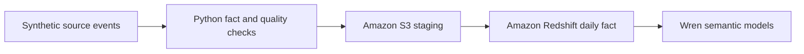

# Binary KPI Semantic Layer

A synthetic subscription analytics project that turns payment events and subscription lifecycles into a governed daily fact. Python builds and profiles the data. Amazon S3 stages the snapshot, Amazon Redshift hosts the fact, and Wren Modeling Definition Language (MDL) exposes the business definitions.



## Why the grain matters

The fact contains one row per **subscription per calendar day**, including active days with no payment. The churn day is included with the churn flag set and the end-of-day active flag clear. Acquisition, churn and payment flags are binary at this grain. A subscriber who pays twice counts once in daily paying subscriptions and twice in successful transactions. A failed attempt and successful payment can both occur on the same day.

| KPI | Governed meaning |
| --- | --- |
| Active subscriptions | End-of-day active subscription count |
| Acquired subscriptions | Subscription starts on the date |
| Churned subscriptions | Subscriptions ending on the date |
| Paying subscriptions | Subscription-days with at least one successful payment |
| Subscriptions with failed payment | Subscription-days with at least one failed attempt |
| Paid transactions | Successful payment events, deduplicated by event ID |
| Revenue | Successful payment amounts in market-local minor units |

Daily payer counts summed over a time period are **paying subscription-days**. Count distinct subscription IDs for unique period payers. Keep raw revenue grouped by market or currency until normalized. The demo does not calculate active-base churn rate or cross-market revenue.

## Run locally

```sh
python3 build_fact.py
python3 make_wren_project.py
python3 -m unittest -v
```

The demo creates `output/subscription_day.csv` with eight rows and `output/profile.json`. The profile records market coverage, binary flag counts, exact duplicate events removed, and key, flag and revenue-reconciliation checks. Conflicting event IDs, payments outside the subscription lifecycle and invalid amounts fail before output. The tests execute the same aggregation SQL against SQLite and check the generated Wren view wiring.

## Deploy on S3 and Redshift

1. Upload the generated CSV to an S3 prefix you control. Keep public access blocked and grant the Redshift COPY role access to that prefix only.
2. Fill in the S3 URI and IAM role in [redshift.sql](redshift.sql). Run it as a writer in a personal Redshift sandbox. This is a full synthetic-snapshot refresh and should have one writer. Redshift primary keys are informational, so Python validates uniqueness before load.
3. Give a separate Wren database user read-only access to the analytics schema and table. Configure a Redshift connection in Wren and bind it to the generated project. Keep connection credentials outside Git.
4. From the generated `wren-project` directory, run `wren context build`. Query `wren.public.daily_market_kpis` and compare its rows to [daily_kpis.sql](daily_kpis.sql) run against the Redshift fact.

A production version would add orchestration, quarantine, profile history and drift thresholds, and a versioned incremental refresh for late events. Python and the local SQL checks were run. Redshift deployment and Wren runtime execution require an AWS sandbox and Wren CLI.

[Wren MDL reference](https://docs.getwren.ai/oss/reference/mdl) · [Wren Redshift connector](https://docs.getwren.ai/oss/guide/connect/overview)
